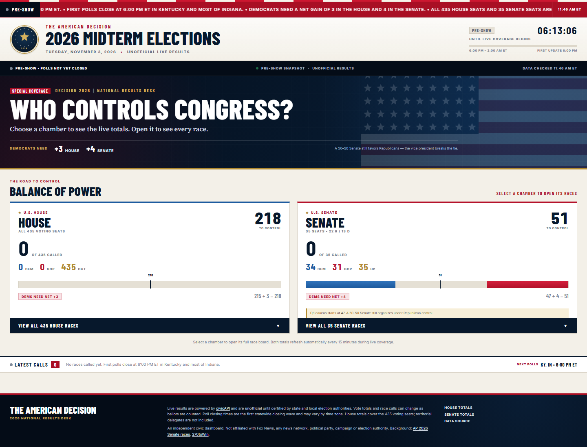

# The American Decision 2026



An independent, self-contained HTML dashboard for live, unofficial 2026 Senate and House results. The landing page stays intentionally short: two large chamber-total cards. Click **House** or **Senate** to expand that chamber's full race board. Opening one closes the other so the landing page stays compact.

## Open it

Double-click **`index.html`**.

> GitHub's repository file viewer shows HTML as source; it does not run the dashboard. Use GitHub Pages (below) or the optional local server to view the rendered page.

If your browser blocks live API requests from a `file://` page, run the tiny included server:

```powershell
node serve.mjs
```

Then open **http://localhost:8080**.

## Coverage window

- **Starts:** Tuesday, November 3, 2026 at **6:00 PM ET (1800 EST)**.
- **Refreshes:** every 15 minutes at :00, :15, :30 and :45.
- **Ends:** **2:00 AM ET**, eight hours after the start.
- **Before 6:00 PM:** pre-show countdown and a current data snapshot; auto-refresh is off.
- **After 2:00 AM:** final snapshot; auto-refresh is disabled.

The page fetches once when opened, then follows the fixed 6 PM–2 AM window. It does not shift the window if opened late.

## What is on the dashboard

- All **35 Senate races**, including the Florida and Ohio special elections.
- All **435 voting House races**, grouped by state and searchable/filterable once expanded.
- A Fox-style red crawl at the top, plus a latest-calls strip and next-poll countdown.
- Two expandable chamber cards: House totals and Senate totals side by side.
- **218 House seats** and **51 Senate seats** to control, with called totals and party splits.
- The Democrats' math: **215 + 3 = 218** in the House and **47 + 4 = 51** in the Senate, with the 50–50 tie rule.
- Each card opens a searchable, filterable race board with candidate percentages and vote totals.
- Key-race markers, Senate seat flips and a race-detail modal with county-level results when available.

## Data

- Live source: [civicAPI](https://civicapi.org), a free public API with no key required.
- One national general-election query is filtered to `US Senate` and `House of Representatives`.
- National aggregates and non-voting territorial delegates are excluded. House totals are the 435 voting seats.
- Race calls and winner flags come from the data provider. **Results are unofficial until certified.**
- The last good snapshot is cached in the browser's local storage for resilience. If the API is unreachable, the dashboard keeps that snapshot on screen, shows an alert, and retries on the normal schedule or when you press Refresh.

## Put it on GitHub Pages

This folder is already a static site: `index.html` is at the repository root, and all CSS, JavaScript and seed data are inlined. No build step is required on GitHub.

```powershell
git init
git add .
git commit -m "Add 2026 election results dashboard"
git branch -M main
git remote add origin https://github.com/USERNAME/REPO.git
git push -u origin main
```

Replace `USERNAME/REPO` with your GitHub account and repository name.

Then, on GitHub:

1. Open **Settings → Pages**.
2. Under **Build and deployment**, choose **Deploy from a branch**.
3. Select **main** and **/(root)**, then save.

The dashboard will be published at:

```text
https://USERNAME.github.io/REPO/
```

The included `.nojekyll` file tells GitHub Pages to serve the files directly. Internal navigation uses `#` anchors, external links use HTTPS, and there are no root-relative or localhost asset paths in `index.html`, so the page works at a repository subpath as well as at a custom domain.

## Notes

- All times are Eastern. November 3, 2026 is on Eastern Standard Time.
- Poll closing times are the first statewide closing wave; some states close at multiple times across time zones.
- "Key race" markers are a watchlist, not a forecast.
- This is an independent civic project. It is not affiliated with Fox News, any news network, political party, campaign or election authority.

## Files

- **`index.html`** — the complete, self-contained dashboard. Open this.
- `src/` — editable source files and the embedded seed snapshot.
- `src/styles.css` — base dashboard, race-card and modal styles.
- `src/styles-v2.css` — simplified two-card landing layout.
- `src/build.mjs` — rebuilds `index.html` from `src/`.
- `serve.mjs` — optional local static server (no dependencies).

## Rebuild

From this folder:

```powershell
node src/build.mjs
```

The build strips byte-order marks and inlines the CSS, JavaScript and seed data into one HTML file.

## Preview mode

Append `?preview=1` to the URL to preview the live-state layout outside the 6 PM–2 AM window:

```text
index.html?preview=1
```

Preview mode is a development aid. It uses the same live data and does not invent results.
